<div align="center">

# 🏥 EPS Analytics

**Análisis de costos de atención en salud por EPS en Colombia**
ETL desde SQL Server o SQLite · KPIs y estadística · pronóstico · reporte Excel automatizado · dashboard interactivo


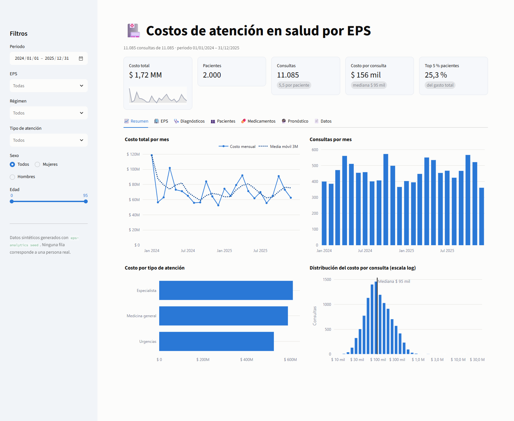

</div>

---

## Tabla de contenido

- [Sobre el proyecto](#sobre-el-proyecto)
- [Funcionalidades](#funcionalidades)
- [Hallazgos con los datos de demostración](#hallazgos-con-los-datos-de-demostración)
- [Capturas](#capturas)
- [Arquitectura](#arquitectura)
- [Modelo de datos](#modelo-de-datos)
- [Inicio rápido](#inicio-rápido)
- [Conexión a SQL Server](#conexión-a-sql-server)
- [Línea de comandos](#línea-de-comandos)
- [Reporte Excel](#reporte-excel)
- [Decisiones técnicas](#decisiones-técnicas)
- [Calidad y pruebas](#calidad-y-pruebas)
- [Estructura del proyecto](#estructura-del-proyecto)
- [Hoja de ruta](#hoja-de-ruta)

## Sobre el proyecto

Las EPS (Entidades Promotoras de Salud) administran la atención de millones de afiliados en
Colombia, y entender **dónde se concentra el gasto** es clave para la gestión del riesgo en salud:
qué diagnósticos pesan más, qué poblaciones consumen más recursos, cómo cambia la demanda a lo largo
del año y qué casos se salen de lo esperado.

Este proyecto nació como trabajo universitario: tres scripts que consultaban SQL Server, calculaban
un promedio y exportaban dos gráficos. Esta versión lo convierte en un **sistema de análisis
completo y probado**:

- un **paquete Python instalable** con CLI,
- un **modelo relacional** en T-SQL con restricciones, índices y vistas analíticas,
- un **generador de datos sintéticos** realista para trabajar sin datos sensibles,
- un **motor de indicadores** con funciones puras y probadas,
- un **modelo de pronóstico** de costo y consultas, validado con backtest,
- un **reporte Excel** listo para gerencia y un **dashboard web** con filtros.

> [!NOTE]
> Todos los datos del repositorio son **sintéticos**. Ningún registro corresponde a una persona real.

## Funcionalidades

| Módulo | Qué hace |
|---|---|
| **Acceso a datos** | SQLAlchemy 2.0. El mismo código funciona con **SQL Server** (pyodbc) en producción y **SQLite** en local o en pruebas. |
| **Datos sintéticos** | 8 EPS con su participación de mercado, régimen contributivo/subsidiado, 10 ciudades, 12 diagnósticos CIE-10 con prevalencia según edad y sexo, estacionalidad de lluvias, medicamentos por diagnóstico y eventos de alto costo. Usa una semilla, así que siempre produce los mismos datos. |
| **Indicadores** | KPIs globales; resúmenes por EPS, diagnóstico (Pareto), grupo etario × sexo y tipo de atención; tendencia mensual con media móvil; matriz EPS × diagnóstico; top de medicamentos; consultas atípicas (Tukey en escala log); pacientes de alto costo; concentración del gasto. |
| **Pronóstico** | Costo y consultas de los próximos meses con intervalos del 90 %. El costo se modela como frecuencia × severidad: consultas con tendencia y estacionalidad, y costo promedio con tendencia robusta (Huber). Se valida con un backtest frente al ingenuo estacional. |
| **Reporte Excel** | 12 hojas con formato de moneda, encabezados, filtros, paneles congelados y **gráficos nativos de Excel**. |
| **Gráficos** | 7 PNG listos para presentaciones, con una paleta validada para daltonismo, sin doble eje y con etiquetas directas. |
| **Dashboard** | Streamlit + Plotly: filtros por periodo, EPS, régimen, tipo de atención, sexo y edad; 7 pestañas, entre ellas una de pronóstico con horizonte ajustable; descarga en CSV/Excel. |
| **SQL** | Esquema, vistas (`vw_CostoConsulta`, `vw_ResumenEPS`) y consultas analíticas con funciones de ventana (Pareto, `LAG`, top 1 %). |

## Hallazgos con los datos de demostración

Con la base por defecto (2.000 pacientes, 11.085 consultas, 2024-2025):

- 💰 **Costo total: $ 1.724 millones**, con un costo mediano por consulta de $ 95.300 y uno promedio
  de $ 155.568. La diferencia entre ambos muestra una distribución con cola larga.
- 📊 **Tres diagnósticos concentran el 47 % del gasto**: infección respiratoria aguda (20 %),
  diabetes tipo 2 (14 %) e hipertensión (13 %).
- 👴 **Un paciente de 60 años o más cuesta 3,1 veces más** que uno de 18 a 29 años
  ($ 1,76 M frente a $ 0,57 M).
- 🎯 **El 5 % de los pacientes más costosos genera el 25 % del gasto**, y **18 consultas atípicas
  (0,16 %) suman el 11,7 %** del costo total.
- 🌧️ **Las consultas por infección respiratoria se duplican** en abril-mayo y octubre-noviembre,
  las dos temporadas de lluvias.
- 🚑 **Urgencias** representa el 13 % de las consultas pero el **30 % del costo**.
- 🔮 **Costo esperado para enero-junio de 2026: $ 426 millones.** En el backtest de 6 meses, el modelo
  se equivoca en promedio un **6,4 %**, frente a un 9,4 % del ingenuo estacional.

## Capturas

### Dashboard interactivo

| Comparativo por EPS | Diagnósticos |
|---|---|
| 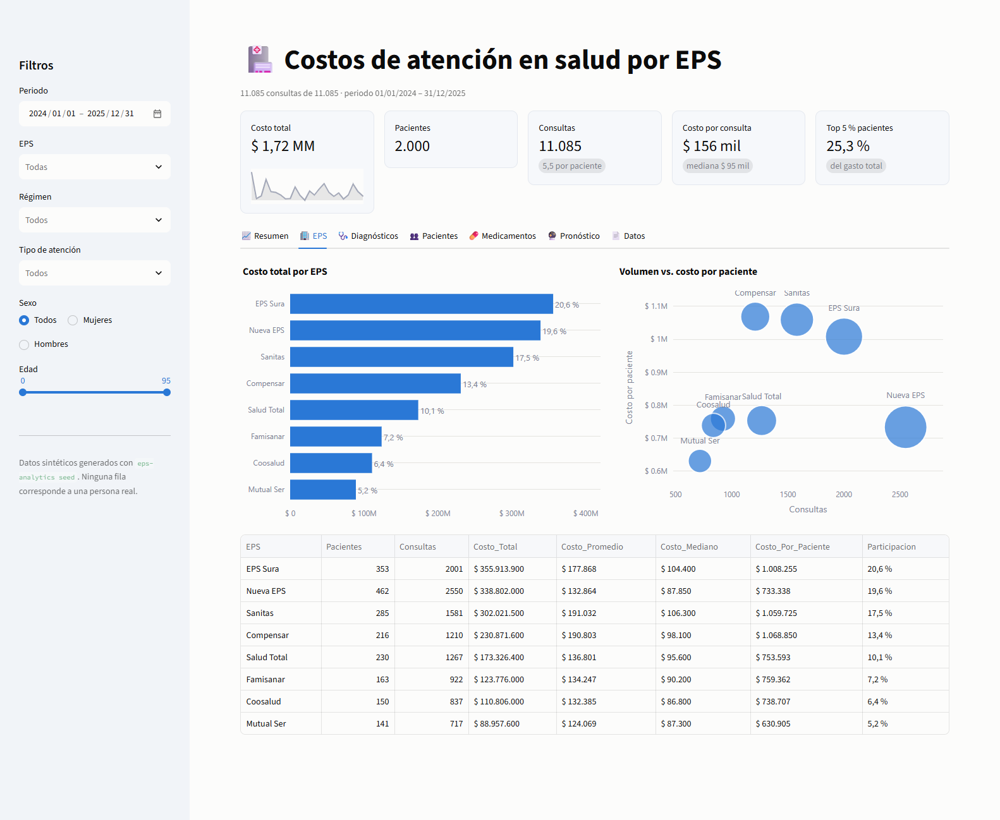 | 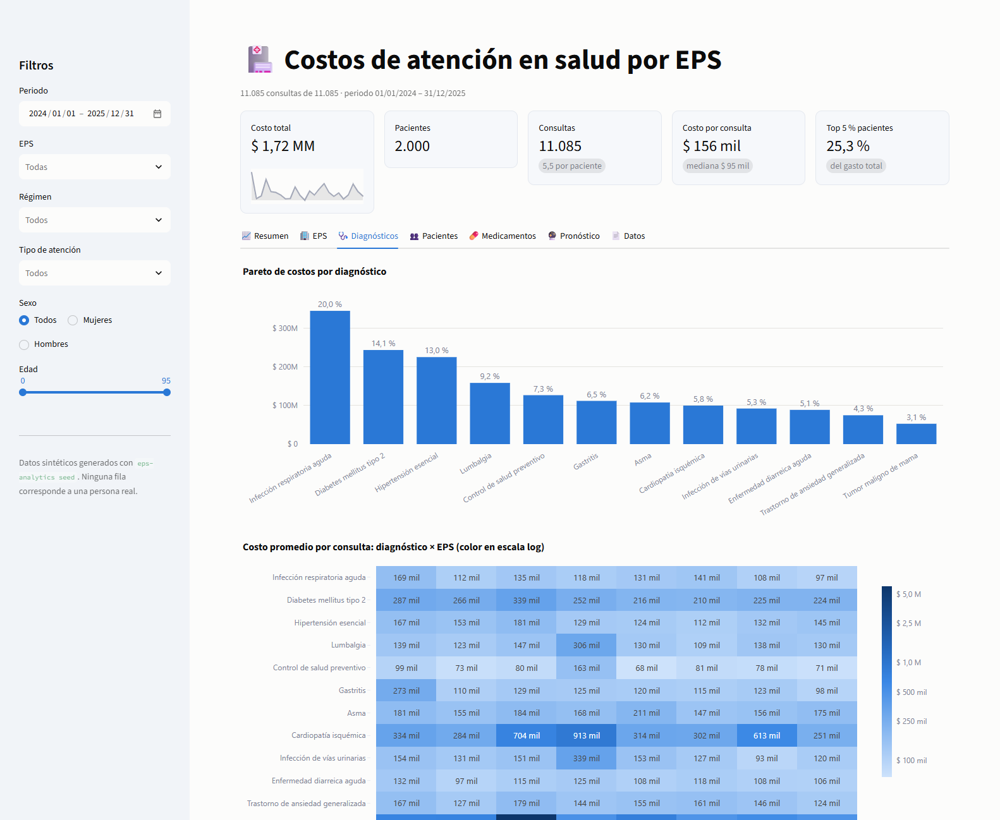 |

| Pacientes | Pronóstico |
|---|---|
| 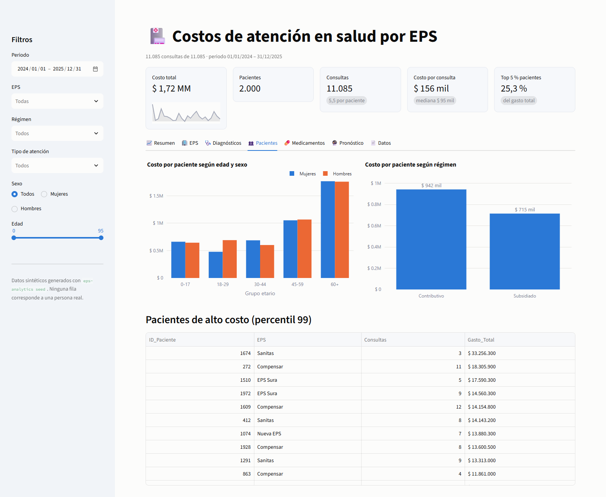 | 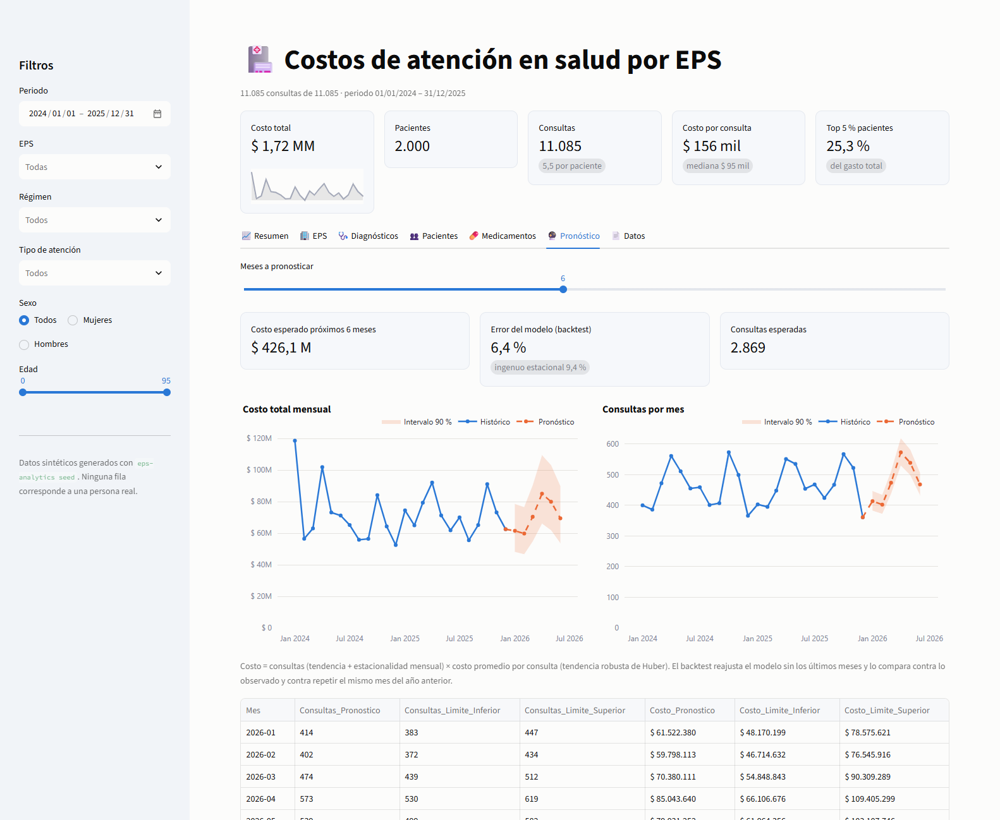 |

### Gráficos del reporte (`eps-analytics report`)

<p align="center">
  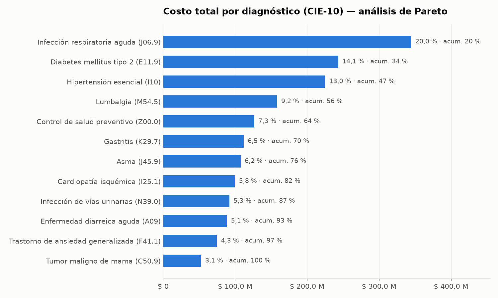
  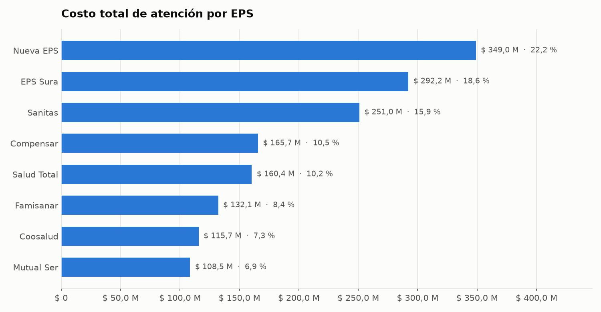
</p>
<p align="center">
  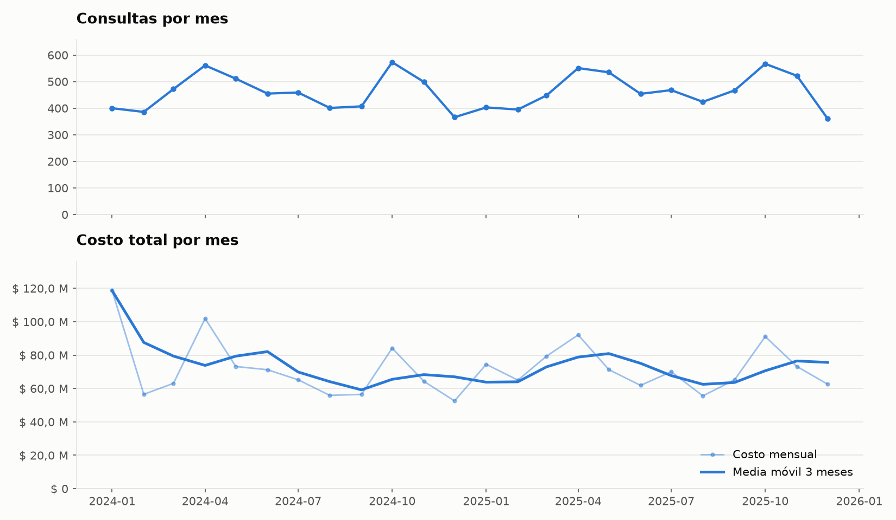
  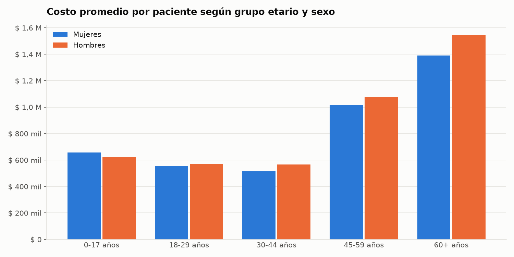
</p>
<p align="center">
  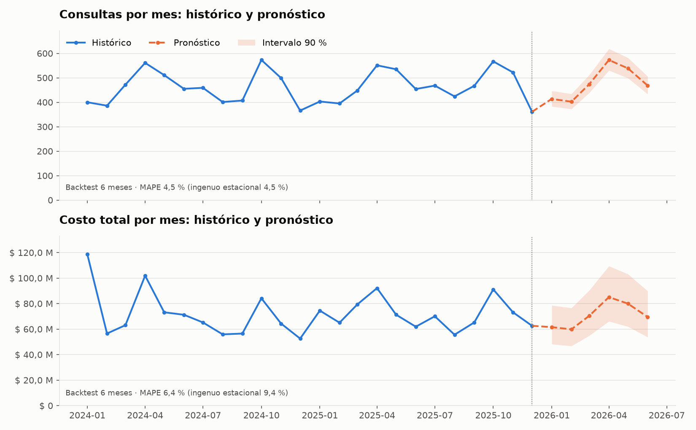
</p>
<p align="center">
  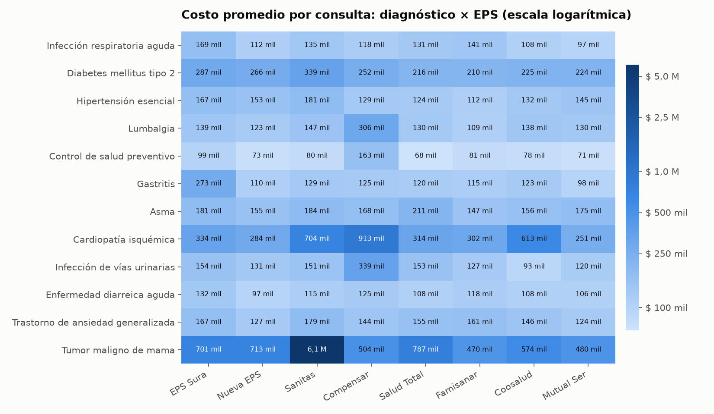
  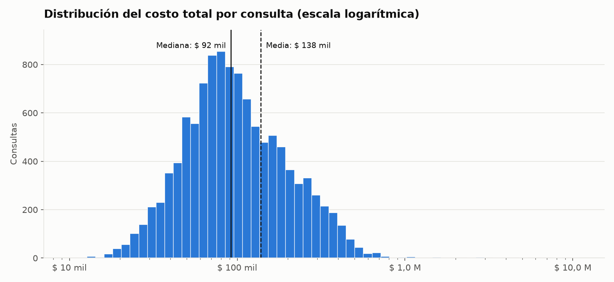
</p>

## Arquitectura

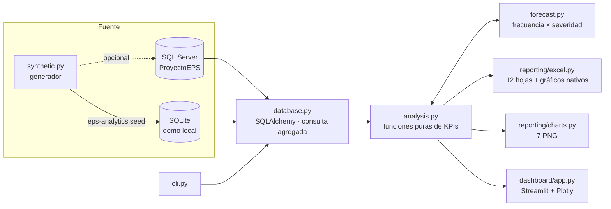

El análisis no conoce la base de datos y la base de datos no conoce el análisis. `analysis.py`
recibe y devuelve `DataFrame`, así que la CLI, el dashboard y las pruebas usan exactamente la
misma lógica.

## Modelo de datos

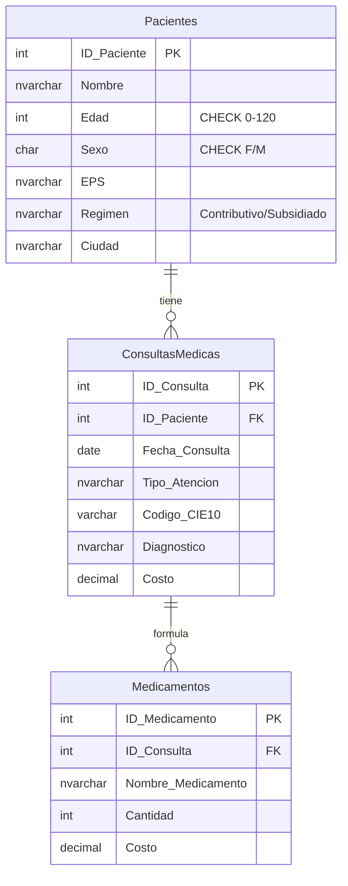

Los scripts de [`sql/`](sql/) crean la base, las vistas analíticas y un conjunto de consultas de
referencia en T-SQL.

## Inicio rápido

Requisitos: **Python 3.10 o superior**. No necesitas SQL Server para probarlo.

```bash
git clone https://github.com/zemogc/AnalisisDatosEps.git
cd AnalisisDatosEps

python -m venv .venv
# Windows
.venv\Scripts\activate
# Linux / macOS
source .venv/bin/activate

pip install -r requirements.txt

eps-analytics seed        # crea data/eps_demo.db con datos sintéticos
eps-analytics report      # genera output/reporte_eps.xlsx y output/graficos/*.png
eps-analytics dashboard   # abre http://localhost:8501
```

> [!TIP]
> El dashboard crea la base de demostración por sí solo si no existe, así que
> `streamlit run dashboard/app.py` también funciona directamente.

## Conexión a SQL Server

1. Crea el esquema y las vistas:

   ```bash
   sqlcmd -S localhost -E -i sql/01_schema.sql
   sqlcmd -S localhost -E -i sql/02_vistas.sql
   ```

2. Instala el driver de Python y apunta la aplicación a tu servidor:

   ```bash
   pip install -e ".[sqlserver]"
   ```

   ```powershell
   # PowerShell, con autenticación de Windows
   $env:EPS_DB_URL = "mssql+pyodbc://@localhost/ProyectoEPS?driver=ODBC+Driver+17+for+SQL+Server&trusted_connection=yes"
   ```

3. Carga datos de prueba con `eps-analytics seed`, o usa tus propios datos, y genera el reporte
   con `eps-analytics report`.

En [`.env.example`](.env.example) están todas las variables reconocidas.

## Línea de comandos

```text
eps-analytics [-v] {seed,report,dashboard}

seed       Genera datos sintéticos y los carga en la base
           --pacientes N   (2000)   --seed N (42)
           --desde AAAA-MM-DD       --hasta AAAA-MM-DD
           --reset         elimina y recrea las tablas

report     Calcula los indicadores y genera el Excel y los gráficos
           -o, --output CARPETA     (./output)

dashboard  Inicia el dashboard de Streamlit
           --port N        (8501)
```

Ejemplo de salida:

```text
$ eps-analytics report
00:12:03 INFO    Pacientes: 2.000 | Consultas: 11.085
00:12:03 INFO    Costo total: $ 1.724.475.000 | Promedio/consulta: $ 155.568 | Mediana/consulta: $ 95.300
00:12:03 INFO    El 5 % de pacientes más costosos concentra 25,3 % del gasto
00:12:03 INFO    Consultas atípicas detectadas: 18
00:12:03 INFO    Costo pronosticado próximos 6 meses: $ 426.115.153
00:12:03 INFO    Backtest costo: MAPE 6,4 % (ingenuo estacional 9,4 %)
00:12:07 INFO    Excel: output/reporte_eps.xlsx
```

## Reporte Excel

| Hoja | Contenido |
|---|---|
| **Resumen** | KPIs, concentración del gasto y gráficos nativos (barras por EPS, línea mensual) |
| Por EPS | Pacientes, consultas, costo total, promedio, mediana, costo por paciente y participación |
| Por Diagnóstico | Ranking por código CIE-10 con participación acumulada (Pareto) |
| Tendencia Mensual | Consultas, costo, variación mensual y media móvil de 3 meses |
| Pronóstico | Consultas y costo esperados con límites inferior y superior (90 %) |
| Grupo Etario | Costos por grupo etario y sexo |
| Tipo de Atención | Medicina general, especialista y urgencias |
| Matriz EPS x Dx | Costo promedio por consulta para cada combinación |
| Top Medicamentos | Formulaciones, unidades, costo total y unitario |
| Consultas Atípicas | Consultas que superan el umbral de Tukey |
| Pacientes Alto Costo | Percentil 99 de gasto acumulado |
| Detalle | Una fila por consulta, con filtros |

## Decisiones técnicas

- **Corrección del JOIN original.** La consulta inicial unía `Medicamentos` directamente con las
  consultas. Eso **duplicaba el costo de la consulta por cada medicamento** y **descartaba las
  consultas sin fórmula**. Ahora los medicamentos se agregan en una subconsulta antes del `LEFT JOIN`.
  Una prueba de regresión (`test_costo_consulta_no_se_duplica`) evita que el error vuelva.
- **Atípicos en escala logarítmica.** Los costos en salud son muy asimétricos. Con el criterio de
  Tukey sobre valores lineales, casi toda consulta de urgencias saldría como atípica. Sobre
  `log(costo)` con k = 3 se detectan los eventos realmente excepcionales.
- **Pronóstico como frecuencia × severidad.** Con solo 24 meses, un modelo con un efecto por mes
  toma un evento de alto costo aislado como si fuera "estacionalidad". La primera versión cometía
  ese error y en el backtest quedaba peor que el ingenuo (14,6 % frente a 9,4 % de MAPE).
  Separar el volumen, que sí es estacional, del costo promedio, que se proyecta con una
  tendencia robusta, bajó el error a 6,4 %. Los intervalos se calculan en escala logarítmica, así
  que son asimétricos y nunca negativos.
- **Mediana junto a la media.** Con colas largas, la media sola engaña, así que el reporte muestra
  ambas.
- **Funciones puras.** `analysis.py` no hace E/S, lo que permite probarlo con DataFrames pequeños
  calculados a mano.
- **Un motor, dos bases.** SQLAlchemy Core define el esquema una sola vez. SQLite permite
  ejecutar las pruebas sin infraestructura, y el T-SQL de `sql/` documenta el despliegue real con
  restricciones `CHECK` e índices de cobertura.
- **Visualización responsable.** La paleta está validada para daltonismo. No hay gráficos de doble
  eje: la tendencia usa dos paneles con el eje X compartido. El heatmap usa escala logarítmica para
  que un caso extremo no aplane el resto, y las cifras van en formato colombiano
  (`$ 1.234.567`, `25,3 %`).
- **Datos reproducibles.** Con la misma semilla se obtienen los mismos datos, lo que permite
  verificar resultados y comparar cambios.

## Calidad y pruebas

```bash
pip install -r requirements-dev.txt
pytest --cov            # 53 pruebas, 98 % de cobertura
ruff check . && ruff format --check .
```

Las pruebas cubren:

- Integridad referencial y dominios válidos de los datos generados.
- Reproducibilidad con la misma semilla.
- KPIs verificados contra valores calculados a mano.
- Pronóstico: recuperación exacta de tendencia y estacionalidad conocidas, robustez ante eventos
  extremos e intervalos coherentes.
- La regresión del JOIN duplicado.
- Contenido y formato del Excel y generación de los gráficos.
- El flujo completo de la CLI (`seed` → `report`).

Las capturas de este README se regeneran con
[`scripts/capturar_dashboard.py`](scripts/capturar_dashboard.py), que usa Selenium con Chrome en
modo headless.

## Estructura del proyecto

```text
AnalisisDatosEps/
├── src/eps_analytics/
│   ├── cli.py              # comandos seed / report / dashboard
│   ├── config.py           # configuración por variables de entorno
│   ├── database.py         # esquema SQLAlchemy y consultas
│   ├── synthetic.py        # generador de datos realistas
│   ├── analysis.py         # KPIs y agregaciones (funciones puras)
│   ├── forecast.py         # pronóstico frecuencia × severidad con backtest
│   ├── formatting.py       # formato de moneda y porcentajes (es-CO)
│   └── reporting/
│       ├── excel.py        # reporte multi-hoja con gráficos nativos
│       └── charts.py       # gráficos PNG
├── dashboard/app.py        # dashboard Streamlit + Plotly
├── sql/                    # esquema, vistas y consultas T-SQL
├── tests/                  # pruebas con pytest
├── scripts/                # utilidades (capturas de pantalla)
├── docs/images/            # imágenes del README
└── pyproject.toml
```

## Hoja de ruta

- [x] Pronóstico del costo mensual con intervalos y backtest.
- [ ] Segmentación de pacientes por patrón de uso (K-Means).
- [ ] Carga incremental desde archivos RIPS.
- [ ] Contenedor Docker con SQL Server para un entorno de punta a punta.

## Autor

**Zemog Gomez** · [@zemogc](https://github.com/zemogc)

Distribuido bajo licencia MIT. Ver [LICENSE](LICENSE).
